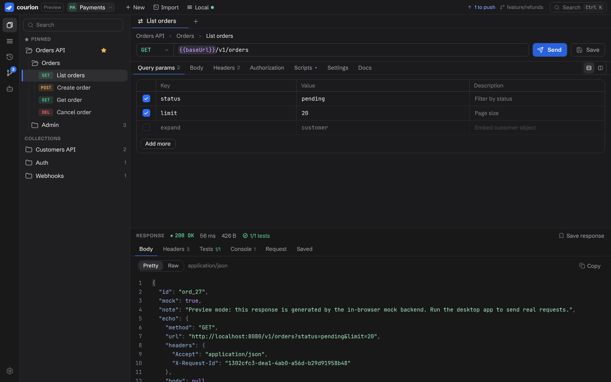
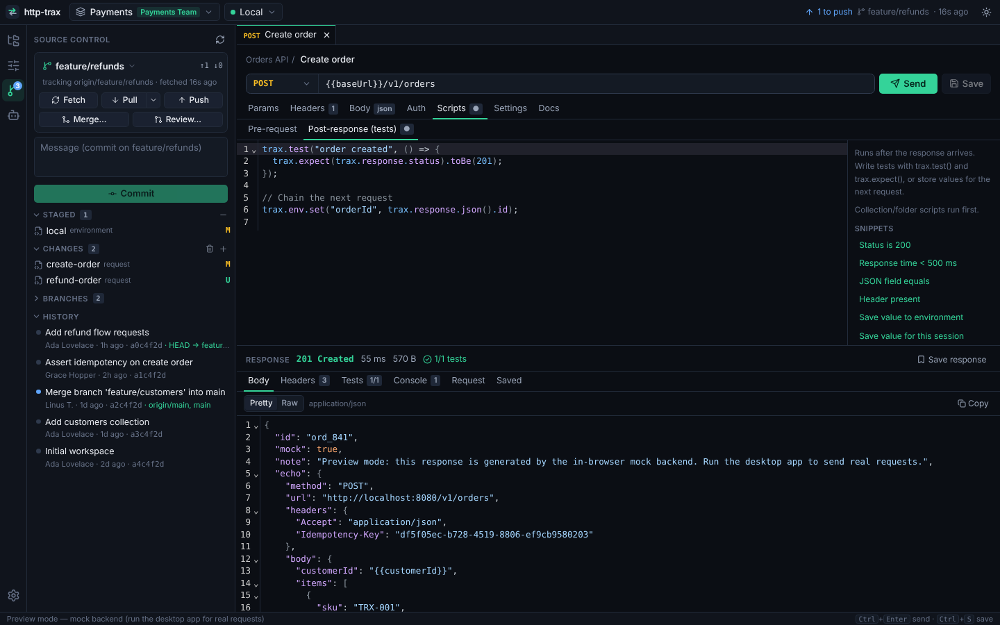
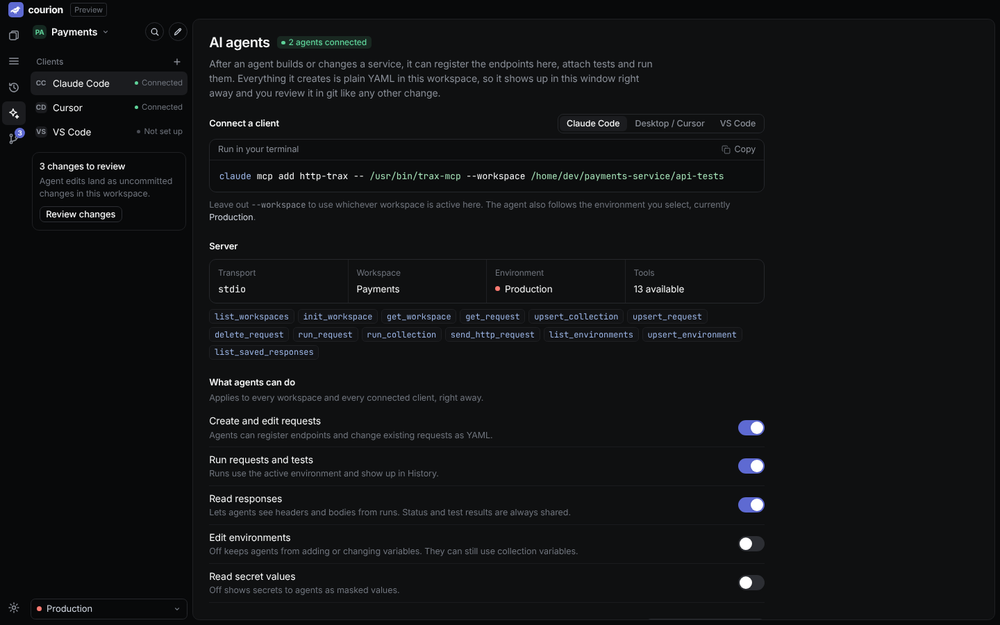

# http-trax

A desktop API client in the spirit of Postman, built around git. Your collections are plain YAML files in a repository, your team syncs through branches and pull requests, and AI agents can create and run API tests through MCP.

Built with Rust and Tauri 2 (backend and desktop shell) and Next.js (UI). Runs on Linux and Windows.

The app's interface carries the name **Courion**. The project, installers, binaries (`http-trax`, `trax-mcp`) and the `trax.*` script API keep the http-trax name for now.



## Features

- **Workspaces for every team.** A workspace is a folder you keep in git: its own repo for a team's shared collections, or `api-tests/` inside a service repo. Switch between as many as you need; the switcher groups them by team. Create one, open an existing folder, or clone a team repository.
- **Bookmarks and scope.** Star a collection to pin it to the top. Use the crosshair to scope the sidebar to one collection and hide everything else.
- **Full git workflow.** Stage, commit, fetch, pull (merge, rebase or fast-forward only), push, branches, merge with conflict resolution, history, and a pull-request style **review** of any branch (commits, changed requests, diff, conflict check) with a one-click link to open the PR on GitHub, GitLab, Bitbucket or Azure DevOps.
- **Always online.** A background worker fetches every workspace and fast-forwards when it's safe (no local commits, no uncommitted edits), so teammates' changes simply appear. It never merges or touches your work.
- **Scripts.** JavaScript pre-request and post-response scripts at request, folder and collection level, with tests and assertions (`trax.test`, `trax.expect`), variable chaining, and a Postman-compatible `pm.*` subset. Scripts run in a sandbox with no file or network access.
- **Saved responses.** Keep known-good responses as examples on a request. They're committed with the workspace.
- **Readable reviews.** Source control shows what changed in a request or environment ("URL changed", "Header added", "Test added") instead of raw YAML, with the line diff one click away.
- **Fast to drive from the keyboard.** Ctrl+K searches every request and command (Ctrl+. for actions), Ctrl+N creates a request, and a pasted cURL command becomes a request. Recent runs are listed under History, HTML responses can be previewed safely.
- **Everyday tools.** `{{variable}}` autocomplete with the resolved value on hover; copy any request as cURL or as fetch, axios, Python, Go or Rust code; search, filter (JSONPath), wrap and save responses; and a per-workspace cookie jar with a cookie manager, so login flows just work.
- **Environments done right for git.** Shared values are committed; secrets and values your scripts set (like fresh tokens) stay on your machine. Keep a whole environment off git with one switch, and mark production as protected so nothing is sent without a confirmation.
- **MCP server for AI agents.** `trax-mcp` ships with the app. After an agent builds or changes a service, it can register the endpoints, attach tests, run them and read the failures. What it creates shows up in the app immediately, as files you review in git. You decide what agents may do (edit requests, run them, read responses, edit environments, see secrets), see which clients are connected, and what they changed.
- **Bring your Postman collections.** Import Postman collections and environments; `pm.*` scripts keep working.





## Install

Download the latest installers from the [releases page](https://github.com/aitoncumbi/http-trax/releases): `.deb`, `.rpm` and `.AppImage` for Linux, `.msi` and a setup `.exe` for Windows, plus standalone `trax-mcp` binaries. Pushing a version tag (`v0.2.0`) builds and publishes a new release automatically; the installers appear on it about 20 minutes later, once the builds finish. Every CI run also uploads the installers as build artifacts.

http-trax uses your installed `git` for all repository operations, so your existing credentials (SSH keys, Git Credential Manager, `gh auth`) just work.

## Connect an AI agent (MCP)

Open the **AI agents** panel in the app for ready-to-paste configs with the right path. For Claude Code:

```sh
claude mcp add http-trax -- trax-mcp --workspace ./api-tests
```

For clients that use an `mcp.json`:

```json
{
  "mcpServers": {
    "http-trax": { "command": "trax-mcp", "args": ["--workspace", "./api-tests"] }
  }
}
```

Leave out `--workspace` to use whichever workspace is active in the app. The agent also uses the environment you've selected there.

| Tool | What it does |
| --- | --- |
| `init_workspace` | Create or open a workspace (e.g. in the service repo) and register it |
| `upsert_environment` | Create/update an environment, e.g. `baseUrl=http://localhost:8080` |
| `upsert_collection` | Collection-level variables, headers, auth and scripts |
| `upsert_request` | Add or update a request, including test scripts |
| `run_request` / `run_collection` | Run and report status, tests, console output and body |
| `send_http_request` | One-off request that isn't saved |
| `get_workspace`, `get_request`, `list_environments`, `list_workspaces`, `list_saved_responses`, `delete_request` | Read and tidy up |

## Scripting in 30 seconds

```js
// Post-response script on "Create order"
trax.test("order created", () => {
  trax.expect(trax.response.status).toBe(201);
  trax.expect(trax.response.json()).toHaveProperty("id");
});

// Chain the next request: stored locally, not committed
trax.env.set("orderId", trax.response.json().id);
```

```js
// Pre-request script on a collection: runs before every request in it
trax.request.headers.set("X-Request-Id", trax.uuid());
if (!trax.env.get("token")) trax.skipRequest();
```

Postman-style scripts work for the common cases: `pm.test`, `pm.expect(x).to.equal(y)`, `pm.environment.set`, `pm.response.to.have.status(200)`.

## Workspace format

```
api-tests/
  trax.yaml                         # workspace name, team, variables
  collections/orders-api/
    collection.yaml                 # shared headers, auth, variables, scripts
    create-order.req.yaml           # one request per file
    admin/folder.yaml
    admin/refund-order.req.yaml
  environments/local.env.yaml
  responses/<request-id>/<id>.yaml  # saved responses
  .trax/                            # local only (git-ignored): secrets, current values
```

```yaml
# collections/orders-api/create-order.req.yaml
id: 6e0c3f0e-8d52-4c56-9a51-1d7f0d7a5c11
name: Create order
seq: 2
method: POST
url: '{{baseUrl}}/v1/orders'
body:
  mode: json
  text: |-
    {
      "customerId": "{{customerId}}"
    }
scripts:
  postResponse: |
    trax.test("order created", () => {
      trax.expect(trax.response.status).toBe(201);
    });
```

See [DESIGN.md](DESIGN.md) for why it looks like this.

## Development

Prerequisites:

- Rust (stable) and Node.js 22
- git
- Linux: `libwebkit2gtk-4.1-dev libayatana-appindicator3-dev librsvg2-dev libxdo-dev libssl-dev build-essential`
- Windows: Microsoft C++ Build Tools and WebView2 (preinstalled on Windows 10/11)

```sh
npm install
npm run app:dev        # desktop app with hot reload (builds trax-mcp first)
npm run dev            # UI only, in the browser, against a mock backend
npm run app:build      # release build + installers in target/release/bundle

cargo test             # Rust tests (core, scripting, git, MCP)
npm run lint && npm run typecheck
```

Project layout:

| Path | |
| --- | --- |
| `crates/trax-core` | Data model, workspace storage, registry, variables, HTTP client, runner |
| `crates/trax-script` | JavaScript sandbox for scripts |
| `crates/trax-git` | Git integration and the background sync pass |
| `crates/trax-mcp` | MCP server (`trax-mcp` binary) |
| `src-tauri` | Tauri app: commands, sync worker, file watcher |
| `src` | Next.js UI |
| `scripts/build-sidecar.mjs` | Builds `trax-mcp` for bundling with the app |

## Roadmap

More importers (OpenAPI, Insomnia, HAR), OAuth 2.0, a CLI runner for CI, semantic merge for request files, PR review through the GitHub/GitLab APIs, MCP over HTTP to drive the live app, and more protocols. See [ROADMAP.md](ROADMAP.md).
